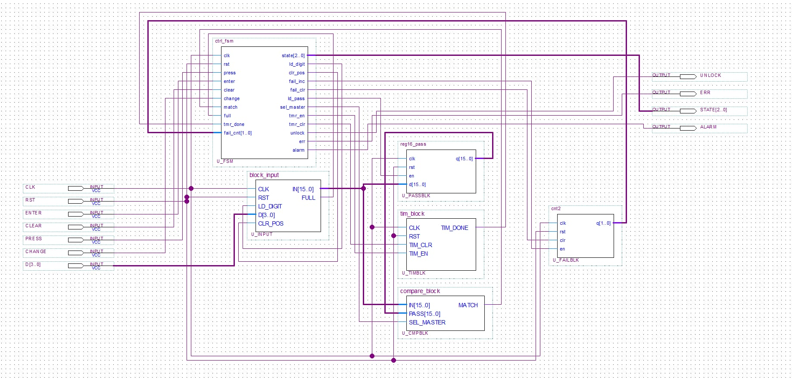
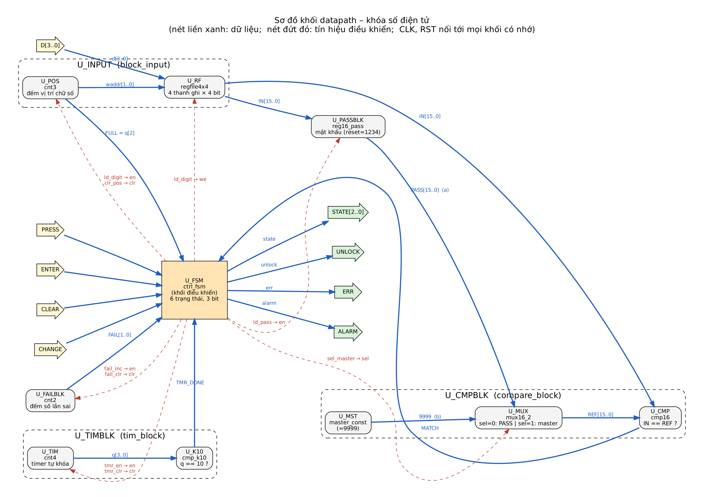
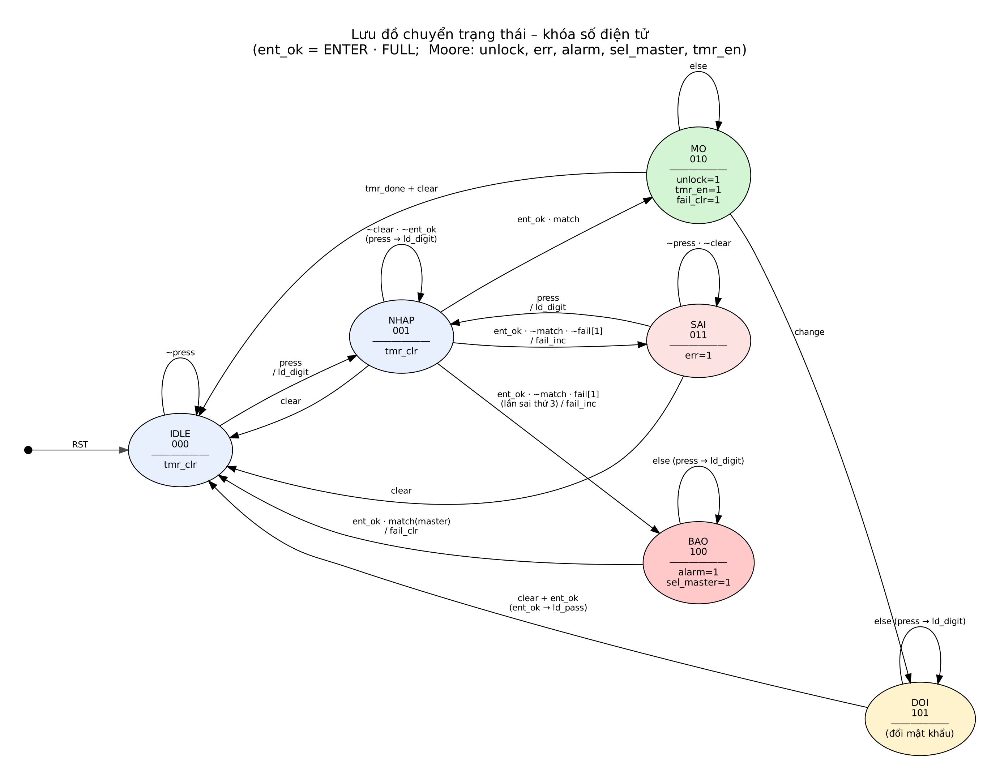
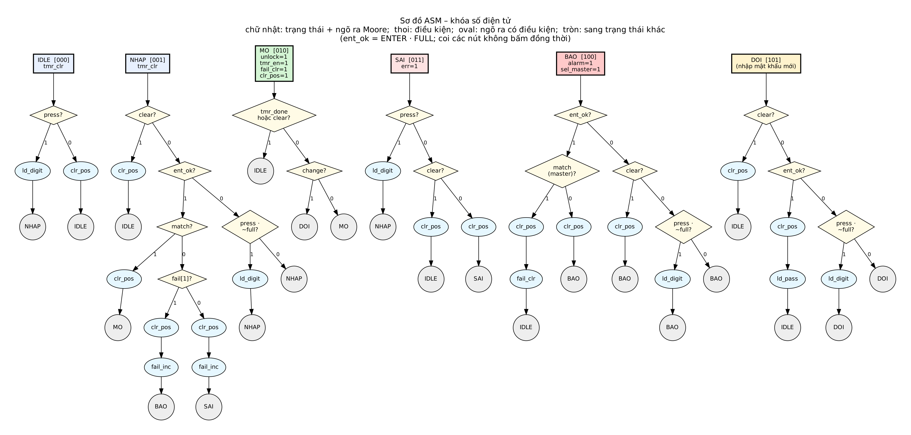
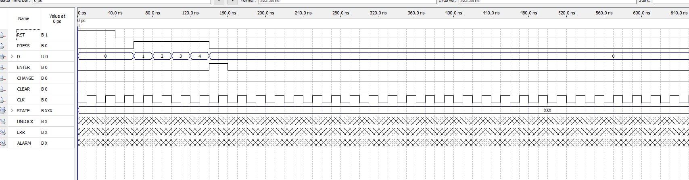
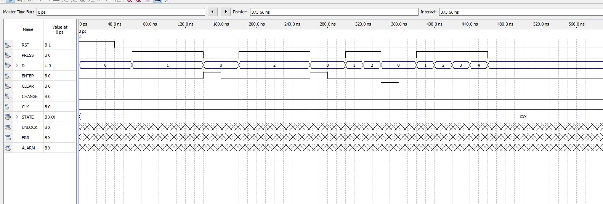
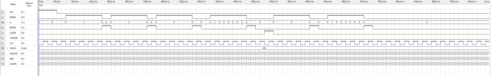
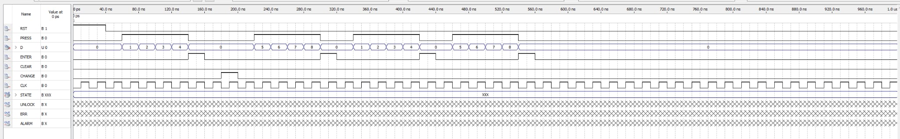

# Hệ thống Khóa Số Điện Tử (Electronic Combination Lock)

Mô phỏng chức năng hoàn chỉnh hệ thống khóa mã số điện tử đồng bộ trên phần mềm **Altera Quartus II** (Môn học: *Thiết kế Luận lý số - CE118*).

Dự án được xây dựng theo mô hình phân rã kinh điển: **Đường truyền dữ liệu (Datapath)** kết hợp **Bộ điều khiển tuần tự (Control Unit / FSM)**, sử dụng sơ đồ khối `.bdf` ở mức đỉnh cùng các khối chức năng được hiện thực bằng **Verilog HDL**, kiểm chứng toàn diện thông qua các tệp mô phỏng dạng sóng vector (`.vwf`) ở chế độ **Functional Simulation**.

---

## Mục lục
1. [Tính năng hệ thống](#1-tính-năng-hệ-thống)
2. [Kiến trúc hệ thống](#2-kiến-trúc-hệ-thống)
3. [Đặc tả cổng giao tiếp vào/ra](#3-đặc-tả-cổng-giao-tiếp-vàora)
4. [Khối điều khiển tuần tự (FSM & ASM)](#4-khối-điều-khiển-tuần-tự-fsm--asm)
5. [Kịch bản và Kết quả kiểm thử mô phỏng (4 Waveform Test Cases)](#5-kịch-bản-và-kết-quả-kiểm-thử-mô-phỏng-4-waveform-test-cases)
   - [Trường hợp 1: Mở khóa đúng mật khẩu và tự động đóng](#trường-hợp-1-mở-khóa-đúng-mật-khẩu-và-tự-động-đóng-t1)
   - [Trường hợp 2: Xử lý nhập sai mã và hủy phím bằng CLEAR](#trường-hợp-2-xử-lý-nhập-sai-mã-và-hủy-phím-bằng-clear-t2)
   - [Trường hợp 3: Báo động an ninh và giải cứu bằng mã Master](#trường-hợp-3-báo-động-an-ninh-và-giải-cứu-bằng-mã-master-t3)
   - [Trường hợp 4: Quy trình thay đổi mật khẩu người dùng](#trường-hợp-4-quy-trình-thay-đổi-mật-khẩu-người-dùng-t4)
6. [Hướng dẫn mở và mô phỏng trên Quartus II](#6-hướng-dẫn-mở-và-mô-phỏng-trên-quartus-ii)
7. [Cấu trúc cây thư mục](#7-cấu-trúc-cây-thư-mục)

---

## 1. Tính năng hệ thống

| Chức năng | Mô tả hoạt động |
|---|---|
| **Nhập mã số** | Nhập tuần tự 4 chữ số BCD ($0 \div 9$). Mỗi chữ số đi kèm một xung `PRESS`, hoàn tất nhấn `ENTER`. |
| **Mở khóa tự động** | Nhập đúng mật khẩu thì ngõ ra `UNLOCK = 1`, cửa tự động khóa lại sau 11 chu kỳ xung nhịp (220 ns). |
| **Cảnh báo lỗi** | Nhập sai mật khẩu thì ngõ ra `ERR = 1`, tăng biến đếm lỗi tích lũy, cho phép nhập lại. |
| **Báo động an ninh** | Nhập sai 3 lần liên tiếp thì kích hoạt `ALARM = 1`, phong tỏa toàn bộ quyền mở bằng mật khẩu thường. |
| **Mã chủ Master** | Đang báo động, nhập đúng chuỗi cố định `9999` + `ENTER` để tắt báo động, xóa đếm sai về 0. |
| **Phím xóa đa năng** | `CLEAR` hủy chuỗi số đang nhập dở, đưa hệ thống về trạng thái chờ, hoặc cưỡng bức đóng khóa ngay khi đang mở. |
| **Đổi mật khẩu** | Khi khóa đang mở, bấm `CHANGE`, nhập 4 chữ số mới và bấm `ENTER` để cập nhật mật khẩu mới. |
| **Khởi tạo mặc định** | Tín hiệu `RST` khôi phục mật khẩu người dùng về `1234`, mã Master cố định `9999`. |

---

## 2. Kiến trúc hệ thống

Hệ thống được thiết kế theo cấu trúc phân rã chuẩn tắc:
* **Khối điều khiển FSM (`ctrl_fsm`)**: Tiếp nhận các xung phím bấm từ người dùng và các cờ trạng thái từ Datapath để sinh tín hiệu điều khiển.
* **Khối nhập dữ liệu (`block_input`)**: Mảng thanh ghi $4 \times 4$ (`regfile4x4`) kết hợp bộ đếm vị trí 3-bit (`cnt3`) ghép 4 chữ số BCD thành bus 16-bit `IN[15..0]` và bật cờ `FULL`.
* **Khối lưu mật khẩu (`reg16_pass`)**: Thanh ghi 16-bit lưu mật khẩu người dùng, nạp mã mới khi có `LD_PASS`, tự reset về `16'h1234`.
* **Khối so sánh mật khẩu (`compare_block`)**: Khối hằng số Master `9999` (`master_const`), bộ ghép kênh 16-bit 2:1 (`mux16_2`) và bộ so sánh bằng 16-bit (`cmp16`) sinh cờ `MATCH` tức thời.
* **Khối định thời (`tim_block`)**: Bộ đếm nhịp 4-bit (`cnt4`) kết hợp bộ so sánh ngưỡng 10 (`cmp_k10`) sinh cờ `TIM_DONE` sau 10 chu kỳ đếm (khóa giữ mở 11 chu kỳ).
* **Khối đếm số lần sai (`cnt2`)**: Bộ đếm 2-bit theo dõi số lần sai liên tiếp, kích hoạt báo động khi sai đến lần thứ 3.

### Sơ đồ kiến trúc mức đỉnh (Top-Level)


### Sơ đồ đường truyền dữ liệu chi tiết (Datapath)


---

## 3. Đặc tả cổng giao tiếp vào/ra

*(Trích xuất trực tiếp từ file đồ họa mạch mức đỉnh `CE118.bdf`)*

| Tên cổng | Chiều | Độ rộng | Cấp tích cực | Chức năng kỹ thuật |
|---|---|---|---|---|
| `CLK` | Vào | 1 bit | Cạnh lên | Xung nhịp hệ thống (chu kỳ $T = 20\text{ ns}$, tần số $50\text{ MHz}$, duty cycle 50%). |
| `RST` | Vào | 1 bit | Mức 1 | Reset đồng bộ toàn bộ thanh ghi, bộ đếm và đưa FSM về `IDLE`. |
| `PRESS` | Vào | 1 bit | Mức 1 | Xung báo có phím số được nhấn (rộng đúng 1 chu kỳ clock). |
| `D[3..0]` | Vào | 4 bit | BCD | Bus dữ liệu mang giá trị chữ số đang nhấn ($0 \div 9$). |
| `ENTER` | Vào | 1 bit | Mức 1 | Xung xác nhận hoàn tất chuỗi 4 số và yêu cầu kiểm tra. |
| `CLEAR` | Vào | 1 bit | Mức 1 | Xung hủy chuỗi đang nhập dở hoặc đóng khóa cưỡng bức khi đang mở. |
| `CHANGE` | Vào | 1 bit | Mức 1 | Xung yêu cầu đổi mật khẩu mới (chỉ có tác dụng khi khóa đang mở). |
| `UNLOCK` | Ra | 1 bit | Mức 1 | Tín hiệu mở khóa cửa (mức 1 = mở), duy trì trong 11 chu kỳ rồi tự đóng. |
| `ERR` | Ra | 1 bit | Mức 1 | Tín hiệu cảnh báo nhập sai mật khẩu. |
| `ALARM` | Ra | 1 bit | Mức 1 | Tín hiệu kích hoạt còi báo động an ninh khi sai liên tiếp 3 lần. |
| `STATE[2..0]` | Ra | 3 bit | Nhị phân | Bus giám sát mã trạng thái hiện tại của khối điều khiển FSM ($0 \div 5$). |

> **Quy ước đồng bộ:** Các ngõ vào thay đổi tại cạnh xuống của xung nhịp (thời điểm $t = 0, 20, 40,\dots\text{ ns}$), đảm bảo thời gian thiết lập (setup time) và thời gian giữ (hold time) lý tưởng trước khi chốt đồng bộ tại cạnh lên (thời điểm $t = 10, 30, 50,\dots\text{ ns}$).

---

## 4. Khối điều khiển tuần tự (FSM & ASM)

### Không gian trạng thái (State Encoding)
* `IDLE` (`000` / `3'd0`): Trạng thái nghỉ/chờ phím bấm đầu tiên.
* `NHAP` (`001` / `3'd1`): Trạng thái tiếp nhận chuỗi ký tự số.
* `MO` (`010` / `3'd2`): Trạng thái mở khóa (`UNLOCK = 1`, kích hoạt bộ đếm thời gian).
* `SAI` (`011` / `3'd3`): Trạng thái báo lỗi (`ERR = 1`), cho phép nhập lại.
* `BAO` (`100` / `3'd4`): Trạng thái báo động an ninh (`ALARM = 1`, chọn so sánh mã Master).
* `DOI` (`101` / `3'd5`): Trạng thái tiếp nhận 4 chữ số mật khẩu mới.

### Sơ đồ chuyển trạng thái FSM


### Lưu đồ giải thuật máy trạng thái (ASM Chart)


---

## 5. Kịch bản và Kết quả kiểm thử mô phỏng (4 Waveform Test Cases)

### Trường hợp 1: Mở khóa đúng mật khẩu và tự động đóng (`T1`)
* **Tệp mô phỏng:** `Mo_khoa_dung_mk.vwf` (Thời gian: 440 ns, End Time $\ge 500\text{ ns}$).
* **Kịch bản:** Reset hệ thống (mật khẩu mặc định `1234`), nhập 4 số `1`, `2`, `3`, `4` bằng 4 xung `PRESS` liên tiếp, sau đó phát xung `ENTER`.
* **Kết quả:** Ngõ ra `UNLOCK` lập tức lên 1 tại chu kỳ 7 ($t = 140\text{ ns}$), duy trì đúng 11 chu kỳ (từ chu kỳ 7 đến 17, tương ứng 220 ns), sau đó tự động hạ về 0 và đưa hệ thống về trạng thái `IDLE` (`000`) tại chu kỳ 18 ($t = 360\text{ ns}$).



<details>
<summary><b>Xem bảng chi tiết từng chu kỳ (T1)</b></summary>

| Chu kỳ | Thời điểm (ns) | RST | PRESS | D | ENTER | CLEAR | CHANGE | STATE | UNLOCK | ERR | ALARM | FAIL |
|:---:|:---:|:---:|:---:|:---:|:---:|:---:|:---:|:---:|:---:|:---:|:---:|:---:|
| 0 - 1 | 0 - 20 | 1 | 0 | - | 0 | 0 | 0 | 000 | 0 | 0 | 0 | 0 |
| 2 | 40 | 0 | 0 | - | 0 | 0 | 0 | 000 | 0 | 0 | 0 | 0 |
| 3 | 60 | 0 | 1 | 1 | 0 | 0 | 0 | 001 | 0 | 0 | 0 | 0 |
| 4 | 80 | 0 | 1 | 2 | 0 | 0 | 0 | 001 | 0 | 0 | 0 | 0 |
| 5 | 100 | 0 | 1 | 3 | 0 | 0 | 0 | 001 | 0 | 0 | 0 | 0 |
| 6 | 120 | 0 | 1 | 4 | 0 | 0 | 0 | 001 | 0 | 0 | 0 | 0 |
| 7 | 140 | 0 | 0 | - | 1 | 0 | 0 | 010 | **1** | 0 | 0 | 0 |
| 8 - 17 | 160 - 340 | 0 | 0 | - | 0 | 0 | 0 | 010 | **1** | 0 | 0 | 0 |
| 18 | 360 | 0 | 0 | - | 0 | 0 | 0 | 000 | **0** | 0 | 0 | 0 |
| 19 - 21 | 380 - 420 | 0 | 0 | - | 0 | 0 | 0 | 000 | 0 | 0 | 0 | 0 |
</details>

---

### Trường hợp 2: Xử lý nhập sai mã và hủy phím bằng CLEAR (`T2`)
* **Tệp mô phỏng:** `Nhap_sai_roi_clear.vwf` (Thời gian: 540 ns, End Time $\ge 600\text{ ns}$).
* **Kịch bản:** 
  1. Nhập sai lần 1 chuỗi `1111` + `ENTER`: Báo lỗi `ERR = 1`, biến lỗi `FAIL = 1`.
  2. Nhập sai lần 2 chuỗi `2222` + `ENTER`: Báo lỗi `ERR = 1`, biến lỗi `FAIL = 2`.
  3. Nhập dở 2 số `1`, `2` rồi nhấn `CLEAR`: Chuỗi dở bị hủy, vị trí xóa về 0, `FAIL` giữ nguyên 2.
  4. Nhập đúng chuỗi `1234` + `ENTER`: Khóa mở (`UNLOCK = 1`), `FAIL` tự động xóa về 0.



<details>
<summary><b>Xem bảng chi tiết từng chu kỳ (T2)</b></summary>

| Chu kỳ | Thời điểm (ns) | RST | PRESS | D | ENTER | CLEAR | CHANGE | STATE | UNLOCK | ERR | ALARM | FAIL |
|:---:|:---:|:---:|:---:|:---:|:---:|:---:|:---:|:---:|:---:|:---:|:---:|:---:|
| 0 - 2 | 0 - 40 | 1 -> 0 | 0 | - | 0 | 0 | 0 | 000 | 0 | 0 | 0 | 0 |
| 3 - 6 | 60 - 120 | 0 | 1 | 1 | 0 | 0 | 0 | 001 | 0 | 0 | 0 | 0 |
| 7 - 8 | 140 - 160 | 0 | 0 | - | 1 -> 0 | 0 | 0 | 011 | 0 | **1** | 0 | **1** |
| 9 - 12 | 180 - 240 | 0 | 1 | 2 | 0 | 0 | 0 | 001 | 0 | 0 | 0 | 1 |
| 13 - 14 | 260 - 280 | 0 | 0 | - | 1 -> 0 | 0 | 0 | 011 | 0 | **1** | 0 | **2** |
| 15 - 16 | 300 - 320 | 0 | 1 | 1, 2 | 0 | 0 | 0 | 001 | 0 | 0 | 0 | 2 |
| 17 - 18 | 340 - 360 | 0 | 0 | - | 0 | **1** -> 0 | 0 | 000 | 0 | 0 | 0 | 2 |
| 19 - 22 | 380 - 440 | 0 | 1 | 1..4 | 0 | 0 | 0 | 001 | 0 | 0 | 0 | 2 |
| 23 | 460 | 0 | 0 | - | 1 | 0 | 0 | 010 | **1** | 0 | 0 | 2 |
| 24 - 26 | 480 - 520 | 0 | 0 | - | 0 | 0 | 0 | 010 | **1** | 0 | 0 | **0** |
</details>

---

### Trường hợp 3: Báo động an ninh và giải cứu bằng mã Master (`T3`)
* **Tệp mô phỏng:** `Bao_dong_va_master.vwf` (Thời gian: 800 ns, End Time $\ge 900\text{ ns}$).
* **Kịch bản:**
  1. Nhập sai liên tiếp 3 lần (`1111`, `2222`, `3333`): Kích hoạt báo động `ALARM = 1` tại chu kỳ 17 ($t = 340\text{ ns}$).
  2. Thử nhập mật khẩu người dùng đúng `1234` khi đang báo động: Bị từ chối, `UNLOCK = 0`, `ALARM` tiếp tục kêu.
  3. Bấm `CLEAR` hủy chuỗi dở.
  4. Nhập đúng mã Master `9999` + `ENTER`: Tắt báo động `ALARM = 0`, xóa `FAIL = 0`, đưa hệ thống về `IDLE`.
  5. Mở khóa lại bình thường bằng mã `1234` thành công (`UNLOCK = 1`).



<details>
<summary><b>Xem bảng chi tiết từng chu kỳ (T3)</b></summary>

| Chu kỳ | Thời điểm (ns) | Thao tác nhập | STATE | UNLOCK | ERR | ALARM | FAIL | Nhận xét an ninh |
|:---:|:---:|:---:|:---:|:---:|:---:|:---:|:---:|---|
| 3 - 7 | 60 - 140 | Sai lần 1 (1111) | 011 | 0 | 1 | 0 | 1 | Báo lỗi lần 1 |
| 8 - 12 | 160 - 240 | Sai lần 2 (2222) | 011 | 0 | 1 | 0 | 2 | Báo lỗi lần 2 |
| 13 - 17 | 260 - 340 | Sai lần 3 (3333) | 100 | 0 | 0 | **1** | 3 | **Kích hoạt ALARM liên tục**, phong tỏa hệ thống |
| 19 - 24 | 380 - 480 | Thử mã 1234 | 100 | 0 | 0 | **1** | 3 | **Bị từ chối**, khóa không mở |
| 25 | 500 | Bấm CLEAR | 100 | 0 | 0 | **1** | 3 | Hủy chuỗi dở |
| 26 - 30 | 520 - 600 | Nhập Master **9999** | 000 | 0 | 0 | **0** | **0** | **Tắt báo động**, xóa sạch lỗi về 0 |
| 32 - 36 | 640 - 720 | Mở lại mã **1234** | 010 | **1** | 0 | 0 | 0 | Mở khóa thành công bình thường |
</details>

---

### Trường hợp 4: Quy trình thay đổi mật khẩu người dùng (`T4`)
* **Tệp mô phỏng:** `Doi_mk.vwf` (Thời gian: 620 ns, End Time $\ge 700\text{ ns}$).
* **Kịch bản:**
  1. Mở khóa bằng mật mã ban đầu `1234`: `UNLOCK = 1`.
  2. Khi đang mở, nhấn xung `CHANGE = 1`: Chuyển sang trạng thái `DOI` (`101`).
  3. Nhập tuần tự 4 chữ số mới `5`, `6`, `7`, `8` và nhấn `ENTER`: Chốt mật khẩu mới `16'h5678` vào thanh ghi lưu trữ.
  4. Thử mở bằng mật mã cũ `1234`: Bị từ chối, xuất cảnh báo lỗi `ERR = 1`.
  5. Thử mở bằng mật mã mới `5678`: Mở khóa thành công (`UNLOCK = 1`).



<details>
<summary><b>Xem bảng chi tiết từng chu kỳ (T4)</b></summary>

| Chu kỳ | Thời điểm (ns) | Thao tác nhập | STATE | UNLOCK | ERR | ALARM | FAIL | Ý nghĩa |
|:---:|:---:|:---:|:---:|:---:|:---:|:---:|:---:|---|
| 3 - 7 | 60 - 140 | Nhập mã 1234 | 010 | **1** | 0 | 0 | 0 | Khóa mở |
| 9 | 180 | Bấm **CHANGE** | 101 | 0 | 0 | 0 | 0 | Chuyển sang chế độ đổi mật khẩu |
| 11 - 15 | 220 - 300 | Nhập mã mới **5678** | 000 | 0 | 0 | 0 | 0 | Chốt mã mới vào thanh ghi, về `IDLE` |
| 17 - 21 | 340 - 420 | Thử mã CŨ **1234** | 011 | 0 | **1** | 0 | 1 | **Mã cũ bị từ chối**, báo lỗi ERR |
| 23 - 27 | 460 - 540 | Thử mã MỚI **5678** | 010 | **1** | 0 | 0 | 1 | **Mã mới mở khóa thành công!** |
</details>

---

## 6. Hướng dẫn mở và mô phỏng trên Quartus II

1. **Khởi chạy project:**
   * Mở phần mềm Altera Quartus II.
   * Chọn `File -> Open Project...` và chọn file `CE118.qpf`.
2. **Biên dịch và tạo Netlist mô phỏng:**
   * Đặt sơ đồ đỉnh `CE118.bdf` làm Top-Level Entity (`Project -> Set as Top-Level Entity`).
   * Chọn `Processing -> Start Compilation` (hoặc `Ctrl+L`).
   * Chọn `Processing -> Generate Functional Simulation Netlist` để tạo netlist mô phỏng chức năng.
3. **Chạy mô phỏng dạng sóng:**
   * Mở file dạng sóng mong muốn:
     - `Mo_khoa_dung_mk.vwf` (Kiểm tra mở đúng)
     - `Nhap_sai_roi_clear.vwf` (Kiểm tra sai và xóa)
     - `Bao_dong_va_master.vwf` (Kiểm tra báo động & master)
     - `Doi_mk.vwf` (Kiểm tra đổi mật khẩu)
   * Nhấn nút **Run Functional Simulation** trên thanh công cụ Waveform Editor để xem kết quả.

---

## 7. Cấu trúc cây thư mục

```text
Electric-lock-quartus/
├── CE118.qpf                   # File quản lý project Quartus
├── CE118.qsf                   # File cấu hình thiết bị và chân gán
├── CE118.bdf                   # Sơ đồ kết nối mạch mức đỉnh (Top-Level)
├── block_input.bdf             # Sơ đồ khối nhập dữ liệu và đệm phím
├── compare_block.bdf           # Sơ đồ khối so sánh mật khẩu và chọn nguồn mã
├── tim_block.bdf               # Sơ đồ khối định thời tự động khóa
├── ctrl_fsm.v                  # Module khối điều khiển tuần tự FSM (Verilog)
├── regfile4x4.v                # Module mảng thanh ghi đệm 4x4 (Verilog)
├── cnt3.v                      # Module bộ đếm vị trí ký tự 3-bit (Verilog)
├── reg16_pass.v                # Module thanh ghi lưu trữ mật khẩu 16-bit (Verilog)
├── master_const.v              # Module sinh hằng số mã Master 9999 (Verilog)
├── mux16_2.v                   # Module bộ ghép kênh chọn mã 16-bit 2:1 (Verilog)
├── cmp16.v                     # Module so sánh bằng 16-bit (Verilog)
├── cnt4.v                      # Module bộ đếm nhịp định thời 4-bit (Verilog)
├── cmp_k10.v                   # Module so sánh ngưỡng 10 chu kỳ (Verilog)
├── cnt2.v                      # Module bộ đếm số lần sai 2-bit (Verilog)
├── Mo_khoa_dung_mk.vwf         # File sóng mô phỏng kịch bản T1
├── Nhap_sai_roi_clear.vwf      # File sóng mô phỏng kịch bản T2
├── Bao_dong_va_master.vwf      # File sóng mô phỏng kịch bản T3
├── Doi_mk.vwf                  # File sóng mô phỏng kịch bản T4
├── Report/
│   └── Assets/                 # Thư mục hình ảnh kỹ thuật và waveform
│       ├── so_do_tong.jpg
│       ├── datapath.png
│       ├── fsm_diagram.png
│       ├── asm_chart.png
│       ├── block_input.jpg
│       ├── compare_block.jpg
│       ├── tim_block.jpg
│       ├── mo_khoa_dung_mk.jpg
│       ├── nhap_sai_va_clear.jpg
│       ├── bao_dong_master.jpg
│       └── doi_mk.jpg
└── README.md                   # Tài liệu hướng dẫn và mô tả dự án
```

---
*Dự án hoàn thành phục vụ môn học Thiết kế Luận lý số (CE118) - Mô phỏng thuần túy trên phần mềm Quartus II.*
